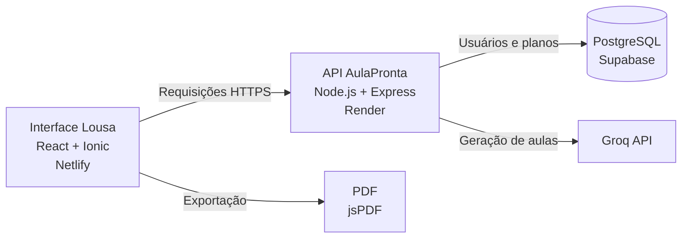

# AulaPronta

### Planejamentos mais simples. Aulas mais organizadas.

**Uma plataforma que une organização pedagógica e inteligência artificial para transformar ideias em planos de aula.**

  
  
  
  
  

[**Conheça a aplicação**](https://lively-speculoos-666a1c.netlify.app/) &nbsp;·&nbsp; [**Repositório**](https://github.com/gabriel-7g/aulapronta-app)

---

## O que é o AulaPronta?

O **AulaPronta** é uma aplicação web voltada a professores que desejam **planejar aulas com mais praticidade, personalização e organização**. Sua interface, chamada **Lousa**, oferece um espaço único para gerar, revisar, armazenar e compartilhar planejamentos em PDF.

A ideia é reduzir o trabalho repetitivo da preparação de aulas sem retirar do professor o controle sobre o conteúdo: a **inteligência artificial auxilia na elaboração**, e o educador pode **editar e adaptar** o resultado à realidade de sua turma.

## Funcionalidades

| Recurso | O que o sistema oferece |
|:--|:--|
| **Planos de aula com IA** | Gera planejamentos a partir de disciplina, tema, turma, nível de ensino, duração e observações do professor. |
| **Edição personalizada** | Permite ajustar o título, modificar o conteúdo e adicionar ou remover seções dos planos. |
| **Biblioteca de planejamentos** | Mantém planos associados à conta do professor para consultar e reutilizar posteriormente. |
| **Busca e organização** | Disponibiliza pesquisa, filtros por matéria e turma e ordenação dos planos. |
| **Exportação em PDF** | Transforma planejamentos em documentos para imprimir ou compartilhar. |
| **Gestão de professores** | O administrador pode cadastrar, listar e excluir contas de professores. |
| **Acesso protegido** | Login com JWT, senhas protegidas por hash e permissões de acesso por perfil. |
| **Consumo de inteligência artificial** | Exibe o uso de tokens e acompanha limites diários de utilização. |
| **Interface adaptável** | Layout responsivo, recursos de acessibilidade e opção de tema claro ou escuro. |

## Inteligência artificial aplicada à educação

A geração de planos utiliza a **API da Groq** para produzir conteúdo pedagógico ajustado às informações fornecidas pelo professor. O sistema orienta a criação de seções e atividades adequadas ao tempo disponível, ao assunto trabalhado e ao contexto da turma.

**Como é a experiência do professor?**

1. **Descreve a aula** — seleciona nível de ensino, matéria, turma, duração e tema.
2. **Adiciona orientações** — informa necessidades ou observações específicas.
3. **Recebe um planejamento** — a IA organiza o conteúdo em seções didáticas.
4. **Personaliza o resultado** — revisa, altera e salva o plano.
5. **Exporta em PDF** — leva o material para a sala de aula ou compartilha com colegas.

> A IA é uma ferramenta de apoio. A revisão e a adequação pedagógica do planejamento continuam sob responsabilidade do professor.

## Perfis de usuário

O AulaPronta separa as permissões de acordo com o perfil autenticado:

| Administrador | Professor |
|:--|:--|
| Gerencia as contas dos professores | Cria planejamentos com auxílio de IA |
| Cadastra e exclui usuários | Consulta, edita, duplica e exclui seus planos |
| Acessa o painel administrativo | Exporta planejamentos e acompanha o consumo de IA |

O acesso ao sistema é realizado por **e-mail e senha**. Na versão atual, o cadastro de professores é feito pelo administrador, sem cadastro público de contas.

## Tecnologias e ferramentas

| Camada | Ferramentas | Papel no projeto |
|:--|:--|:--|
| **Interface** | React, Ionic React, TypeScript, Vite | Experiência web responsiva e interativa |
| **Servidor** | Node.js, Express, TypeScript | API e regras de negócio |
| **Persistência** | PostgreSQL, Prisma ORM | Usuários e planejamentos |
| **Inteligência artificial** | Groq SDK | Geração de conteúdo pedagógico |
| **Documentos** | jsPDF | Exportação de planos em PDF |
| **Segurança** | JWT, bcryptjs, Helmet, CORS, rate limiting | Autenticação e proteção de rotas |
| **Testes** | Vitest, Cypress | Ferramentas de testes unitários e ponta a ponta |
| **Hospedagem** | Netlify, Render, Supabase | Frontend, backend e banco de dados |

## Como a plataforma se conecta

O **frontend** concentra a experiência de uso; o **backend** valida permissões, processa as operações e integra a IA; o **banco de dados** mantém os registros; e o **gerador de PDF** permite levar os planejamentos para fora da plataforma.

## Propósito

Mais do que automatizar um documento, o AulaPronta busca oferecer um **ambiente de trabalho organizado para professores**, reunindo preparação, personalização e histórico de aulas em um só lugar.

O projeto também demonstra, na prática, a integração entre **frontend, backend, banco de dados, autenticação e inteligência artificial** em uma aplicação web completa.

---

**AulaPronta · Lousa**

*Tecnologia para apoiar quem ensina.*

Desenvolvido e mantido em [**@gabriel-7g**](https://github.com/gabriel-7g).

